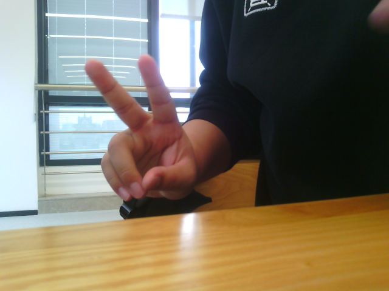

# 实验八 · 镜纳星光

## 目标与环境

使用 Qt 控制 Camera，参考《I.MX6U 嵌入式 Qt 开发指南》V1.1 第 562 页起相关内容。在 I.MX6ULL ALPHA 上接入 OV5640 CSI 摄像头，完成实时预览、拍照保存、停止和重新打开。板端为 Linux `4.1.15-g3dc0a4b`、Qt 5.12.9、OpenCV 3.1.0，linuxfb 显示为 1024×600。

## 实现与编译

`qt_camera/` 是本次应用源码，`参考例程/` 保留教材 `05_opencv_camera` 的原作者声明。Qt Widgets 负责交互、显示和 PNG 保存，OpenCV 通过 V4L2 采集。CameraWorker 在工作线程读取图像，转换为 RGB 并深拷贝 QImage，最多积压一个待显示帧。没有有效帧时禁止拍照，停止后清空画面并恢复打开操作。

本次实际使用 Linaro GCC 5.5、Qt 5.12.9 开发配置、OpenCV 3.1.0 公开头文件和板端库副本交叉编译，没有替换板端 Qt、OpenCV 或固件。`tools/build_arm.sh` 是历史构建入口，包含 `/home/little/lab7-sdk`、`/home/little/lab8-sdk` 和原实验路径，迁移前需按自己的 SDK 调整。归档后的日志位于 `构建记录/arm.log`，可运行 ARM 程序为 `bin/qt_camera_arm`。

所需依赖见根目录 [资料索引](../资料索引.md)。工具链、OpenCV 源码归档和板端库大归档不随仓库上传。

## 板端运行

将 `bin/qt_camera_arm` 和 `run_on_board.sh` 放到板端 `/home/root/lab8`，赋予程序执行权限，再运行：

```sh
cd /home/root/lab8
chmod +x qt_camera_arm
sh ./run_on_board.sh
```

本板 `/dev/video0` 是 PxP，`/dev/video1` 是 mx6s-csi。界面选择 `/dev/video1`，请求 640×480，再点击“打开摄像头”。设备编号可能随硬件和系统改变，先读取 `/sys/class/video4linux/videoN/name` 核实。

点击“拍照保存”将当前帧写入 `/home/root/lab8/photos`。点击“停止”后可再次打开；启动脚本暂时暂停 QDesktop，正常退出时按脚本恢复。本次未验证退出恢复。未设置开机自启动，重启后需手动运行。程序已部署时，采集、显示和保存均在板端完成，运行无需网线。

## 结果与证据

2026 年 11 月 16 日接入实体 OV5640：现场确认实时画面、拍照、停止和重新打开成功。串口检查确认板端有两张 640×480 PNG，并取回第一张原图 352739 字节；详见 [实验完成记录](实验完成记录.md) 与 `实测记录/摄像头实测串口验证.txt`。



上图是保存的摄像头照片。开发板时钟未校准，文件名中的 2021 年日期不是实际实验日期。`01_接口预留界面.png`、`02_设备未连接提示.png` 和无摄像头自检日志来自此前准备阶段，不是本次真实取景截图。

代码中的 10 fps 是请求值，未测实际帧率；热拔插、长时间稳定性及其他摄像头兼容性未验证。旧版 V4L2 读取可能阻塞，停止操作需等待当前读取返回。

`tools/取回实拍照片.ps1` 是本次串口取回记录的工具，包含 COM3 和固定历史文件名，复用前需调整；不会替代通用文件传输工具。
